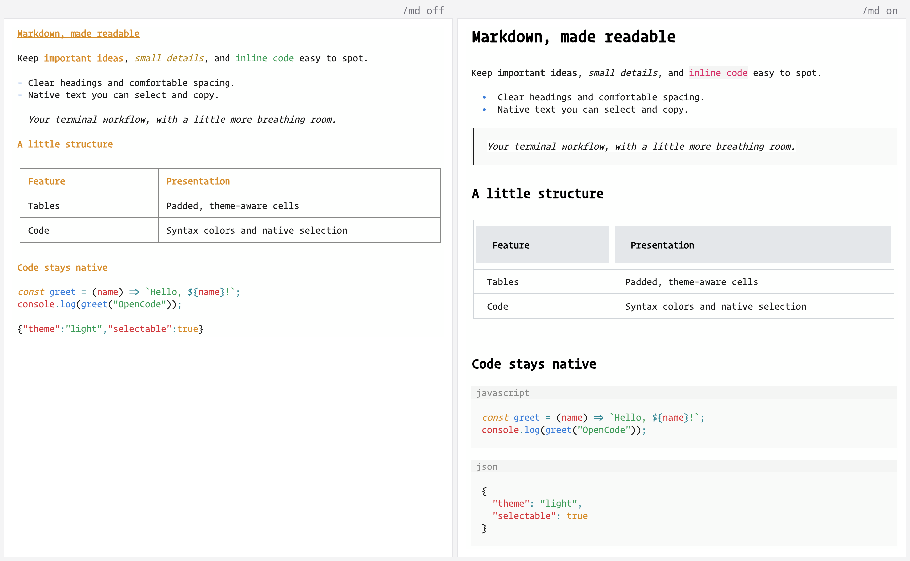

# md — Markdown styling for OpenCode TUI

Richer Markdown for your terminal workflow, without switching to a web view or a
custom app.

One OpenCode 2 TUI plugin for Markdown typography, tables, lists, blockquotes,
code blocks, formatted JSON, and enlarged headings, controlled by one on/off switch.
Enlarged headings use small cached PNGs, drawn with Skia through `@napi-rs/canvas`.
All styling runs inside OpenCode's existing terminal transcript.

[](docs/images/before-after.png)

## Install

Requires OpenCode 2 and Node.js/npm for dependency installation. A terminal
with Kitty graphics support, such as Ghostty, enables enlarged headings.

```sh
git clone https://github.com/MErkinSag/opencode-md.git
cd opencode-md
npm ci
```

Add the checkout's absolute path to the existing `plugins` array in
`~/.config/opencode/cli.json`:

```json
{
  "plugins": ["/absolute/path/to/opencode-md"]
}
```

Keep any other plugin entries. Run `/reload` in OpenCode to load the plugin.
The package name and TUI plugin ID are both `md`. Keep the checkout in place;
OpenCode loads the plugin directly from it.

## Commands

- `/md on` — enable all Markdown styling, including enlarged headings.
- `/md off` — restore OpenCode's native Markdown presentation.
- `/md` — toggle the whole plugin's styling.
- `/md status` — show styling/heading status, font family, and raster count.

All styling starts on in each TUI. Terminals without image support use styled
native-size headings automatically. If an existing TUI does not list `/md`, run
`/reload` to reload plugins.

### Headings

Headings use the font family selected in Ghostty.
Loading the plugin and `/md on` read `ghostty +show-config` asynchronously,
including its effective configuration precedence and included files. After
changing the terminal font, run `/md on` again to refresh existing headings.
The font is used for measuring, wrapping, selection geometry, and drawing. If
Ghostty is unavailable, the last detected family is retained, or system monospace
is used on the first run. Font discovery never runs during rendering or scrolling.
Headings request bold (700). Families with no installed bold face also get a
small font-scaled outline for
visible weight; layout accounts for it when wrapping and preserving the gaps.
Both native and enlarged headings use black in light mode, and a neutral
off-white in dark mode.

### Inline typography

Bold and italic Markdown use the normal text color with native bold/italic
attributes. Inline code uses a pink-red (`#d6336c`) foreground on a subtle raised
background; dark mode uses a lighter rose (`#fb7185`) for contrast.
Link labels and URLs share the theme's link accent and retain native hyperlinks.
These styles also apply inside lists and quotes.

Everything stays native and selectable, with no extra inline padding or images.
The plugin caches a private copy of the native syntax style table, updating it
when the source theme or palette changes. It does not modify the shared theme.
Scrolling and streamed text reuse the existing style table; tables are restored
and native resources released when the adapter is detached.

### Tables

Tables have a gray header with bold black labels and uniform white body rows.
Body cells have two spaces on each side; header cells have three.
Backgrounds fill each cell's entire interior,
including vertical/horizontal padding, empty cells, and wrapped lines. The outer
border and inner grid keep their own neutral color. Inline code retains its
pink-red text and a soft light-gray background.
The header has one filled padding row above and below its column labels. Body
rows use compact native vertical spacing; terminal text cannot use fractional-row
padding. Tables expand to the available width and keep native wrapping, links,
and mouse selection.
Dark mode uses the equivalent dark-gray surfaces with light text.

These are native terminal tables, not images. Changed cells are styled once;
scrolling and resize reuse the styled content. A native cell-fill pass supplies
the backgrounds through OpenTUI's existing table drawing and selection path.

### Fenced code blocks

All Markdown code fences use a native panel with a subtle background, padded
content, and a lowercase language label on a contrasting full-width title row
(slightly darker in light mode). This includes `text`, `txt`, `plaintext`, bare
triple-backtick fences, and programming languages. Unlabelled blocks use `text`.
Each box has one blank row above it, outside the shaded panel. The title row sits
at the panel's top edge. Content has two spaces of padding on each horizontal side.
Native syntax highlighting, selection, and streaming are preserved. Markdown
inside a fence stays literal, including asterisks, backticks, and indentation.
Custom code-block widgets supplied by other plugins retain their own presentation.

Valid `json` is additionally indented with two spaces. These features are active
whenever `md` styling is on; `/md off` and source mode restore native presentation.

Formatting changes only whitespace: large numbers, duplicate keys, key order,
and string escapes are preserved exactly. Incomplete/invalid JSON remains
literal while streaming. Blocks over 1 MB or with extreme nesting use their
original text for responsiveness. Other fence contents, including `jsonc`, are
preserved exactly. Inline JSON and raw tool output retain their existing handling.
All code remains selectable; message-copy actions use the original message source.

Body text, code blocks, links, tool interactions, menus, and the composer use
OpenCode's own widgets. Headings support ordinary mouse drag selection, visible
highlighting, and copying through OpenCode's native selection system, including
drags into adjacent paragraphs. Partial selections map terminal cells onto the
actual font glyphs; wrapped lines and Unicode graphemes retain their
logical text. Terminal-owned selection (bypassing OpenCode's mouse handling)
cannot read images. Source-mode Markdown keeps its native syntax.

### Blockquotes

Markdown `>` quotes have a theme-aware left rule, subtle background, and padded
content. They use OpenCode's native quote/text widgets, preserving selection,
inline formatting, lists, nested quotes, and streaming text. Like JSON styling,
this is enabled whenever `md` styling is on.
Ordinary quotation marks in prose do not create a blockquote.

### Bullet and numbered lists

Lists use native, selectable text with two cells of extra indentation and a
little more space after the marker. Bullets use `•`, alternating with `◦` for
nested lists. Numbered lists retain their starting number and right-aligned
number column, including transitions from one to two digits. Wrapped lines
stay aligned beneath the item text.

Lists keep one blank row above and below the whole block, shared between
adjacent lists. A final item's trailing blank line is removed so it does not
double the bottom spacing. Native terminal spacing uses whole rows.

Inline formatting and task checkboxes are retained, including streamed updates.
The older renderer's missing checkbox markers are restored from its parsed task
state. Styling is active whenever `md` is on; source mode keeps native
markers. No list images are created. Decoration runs when native list blocks
are created or updated, with no extra list-decoration work during scrolling.

## Implementation

The public OpenCode plugin API currently exposes code-block overrides, not a
transcript heading hook. The adapter discovers `MarkdownRenderable`
instances through the renderer and wraps their public `renderNode` (OpenTUI 0.8)
or `renderBlock` hook. The adapter styles quotes/lists and replaces
headings; other callbacks are preserved. On OpenTUI 0.8 it also wraps native list
creation/update methods because streaming can bypass the block hook. Original
hooks and methods are restored on plugin
cleanup. This is version-sensitive integration, verified on **OpenCode
2.3.0**, not a stable upstream heading-extension API.

Raster keys include text, font family, level, available width, cell density, foreground and
background. Long headings wrap by words/graphemes. Images occupy only the width
needed by their text. The raster LRU accounts for both PNG bytes and decoded
pixels, capped at 8 MiB. Mounted native image widgets also retain their own
resources, released with their Markdown widget or when toggled off.

Cached headings update layout only when spacing or size changes, allowing an
idle transcript to settle without scheduling another frame. On the detected
`renderNode` engine, streamed fences retain their panel and native code buffer.
A small factory adapter still calls registered renderers for each changed token.
Third-party callbacks receive fresh defaults, preserving conditional widget
customizations as well as content-dependent replacements. Native reconciliation owns
removal, ordering, source-mode changes and forced style refreshes (including
stream completion). Unrecognized engines retain their normal rendering path.

The adapter scans the current process's mounted renderer tree, including mounted
offscreen Markdown. It does not enumerate saved sessions or other TUI processes.
The OpenCode 2.3.0 smoke probe switches between its own session tabs and records
which transcripts remain mounted. Terminal keyboard focus is not a reliable
pane-visibility signal, so the plugin does not suspend rendering based on focus.

The heading image implements OpenTUI's selectable-renderable contract. Glyph
bounds and source offsets are retained with each raster. Selection highlights
are painted from that cached raster; they do not rerender the text or document.
Native selection collection combines the heading's selected substring with
body text for the existing copy action.

Scrolling uses OpenTUI's existing image placements and clipping; no image is
rasterized again just because its screen position changes. Resize and theme
changes invalidate the relevant keys. Enlarged headings require a terminal
reporting Kitty graphics support; verified visually in cmux's Ghostty-backed terminal.

## Verification

```sh
npm test
python3 test/smoke.py
MD_TEST_THEME_MODE=dark python3 test/smoke.py
```

The smoke test uses the installed OpenCode binary with private PTY capability
replies and a newly imported test transcript. Its own client exits normally through
`app.exit`; saved test sessions are retained, and no existing client is controlled.
Its test-only plugin exercises
streaming against the mounted Markdown widget without a model call. It verifies:

- Native body text emitted alongside heading graphics.
- Heading drag selection returns the exact heading text (regression previously
  returned an empty string).
- Forward and reverse selections span headings and native body text.
- Unit checks cover partial, wrapped Unicode, word, and cleared selections.
- Thirty wheel events with **zero additional heading rasters**.
- Settled enlarged headings produce **zero frames and terminal bytes** during
  the idle observation window.
- Actual terminal resize and resulting narrower layout.
- `/md off` restores native Markdown, including indentation, JSON, quotes, tables, and
  headings; `/md on` restores all styling together.
- Terminals without image support retain styled native headings and body text.
- New/changing streamed headings render without errors.
- Valid JSON is formatted in live native code widgets; incomplete JSON remains
  literal, including across streaming updates. Large integer tokens survive.
- Text, unlabelled, programming-language, JSONC, and unknown-language fences get
  filled native panels. Tests cover syntax colors, literal content, selection,
  incomplete streaming, code-only Markdown, source mode, and `/md off` restoration.
- Streamed fence chunks preserve panel/code-buffer identity and padded geometry;
  unchanged panels are reused. Third-party callbacks still run once per changed
  token and can switch between native code and their own widgets.
- Quotes retain native drag selection and accept streamed content.
- Bullet/numbered lists retain nesting, starting numbers, hanging alignment,
  native selection, and wrapping after resize.
- Streamed lists retain circle markers, aligned number columns, and checkbox
  states. Source-mode toggling restores native markers and returns to styling.
- Ten list wheel events with **zero additional list decoration or rasters**.
- Real painted text spans verify neutral bold/italic text, inline-code
  backgrounds, and consistent link colors in paragraphs, lists, and quotes.
  Native selection and hyperlinks work in light and dark modes.
- Inline styling survives streaming with **zero style-table rebuilds**;
  scrolling also reuses the cached native styles.
- Black/neutral headings and pink-red inline code are checked in both modes.
- Padded table headers (including wrapped labels), compact uniform body rows,
  empty cells, wrapped continuations, native selection, streaming, and resize
  are checked against painted terminal cells. Header/column copying excludes padding.
  Scrolling and resize perform **zero additional table-cell styling**.

Each run records raster counts, timing, and cache memory in `artifacts/result.json`.
Set `MD_TEST_ARTIFACTS` to keep separate runs. The same directory records retained
test session IDs and the client's normal exit status in `retained-sessions.json`.
Scrolling must leave the raster count unchanged. These are renderer measurements,
not GPU frame-time or end-to-end latency claims. Test artifacts are generated
locally and excluded from version control.

## Remove

Run `/md off`, then remove this project's entry from the `plugins` array in
`~/.config/opencode/cli.json`.
